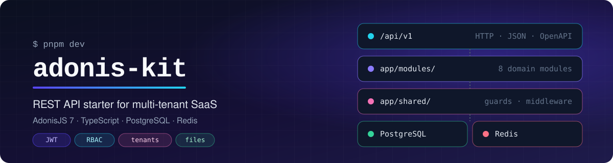
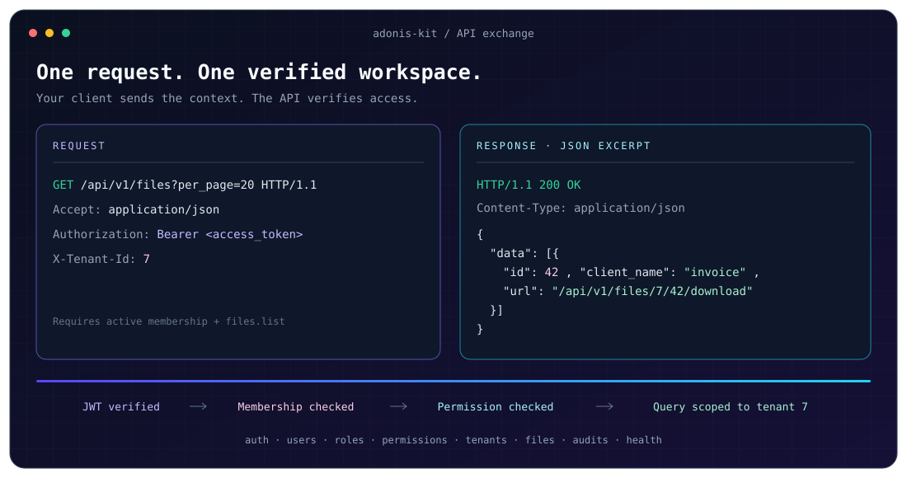

<div align="center">



<p>
  <a href="https://nodejs.org/"></a>
  <a href="https://adonisjs.com/"></a>
  <a href="https://www.typescriptlang.org/"></a>
  <a href="https://www.postgresql.org/"></a>
  <a href="https://redis.io/"></a>
  <a href="https://github.com/gabrielmaialva33/adonis-kit/actions/workflows/ci-cd.yml"></a>
  <a href="package.json"></a>
  <a href="LICENSE"></a>
</p>

[English](README.md) · **Português**

---

_"A base da sua API, do primeiro login ao próximo workspace."_



</div>

---

> [!IMPORTANT]
> **adonis-kit é um starter de API REST para SaaS multi-tenant.** AdonisJS 7, módulos por domínio, autenticação JWT,
> refresh tokens rotativos, workspaces, RBAC hierárquico e armazenamento privado já estão conectados.
> Conecte seu cliente web, mobile ou serviço. Edge é usado para templates de email.
> O template é **pré-1.0 (0.9.0)**: consulte [MIGRATION.md](MIGRATION.md) antes de adotá-lo em uma aplicação existente.

## Visão geral

<table>
  <tr>
    <td width="33%" valign="top"><h3>🔐 Ciclo de vida da conta</h3>Cadastro, login, verificação de email, recuperação de senha, refresh tokens rotativos e exclusão da conta.</td>
    <td width="33%" valign="top"><h3>🏢 Workspaces por tenant</h3>Participação N:N via <code>user_tenants</code>, seleção de workspace ativo e arquivos privados por tenant.</td>
    <td width="33%" valign="top"><h3>👥 RBAC hierárquico</h3>Papéis globais, permissões herdadas, concessões diretas e temporárias, ownership e cache de permissões no Redis.</td>
  </tr>
  <tr>
    <td valign="top"><h3>📁 Armazenamento privado</h3>Upload, listagem, download e exclusão em filesystem, S3, DigitalOcean Spaces, Cloudflare R2 ou GCS.</td>
    <td valign="top"><h3>📖 Contratos HTTP</h3>Endpoints JSON, validação VineJS, rate limiting, OpenAPI, ReDoc e exemplos HTTP executáveis.</td>
    <td valign="top"><h3>🧪 Validação do backend</h3>Suítes Japa unitárias e funcionais, checagens de deployment e integração com PostgreSQL e Redis.</td>
  </tr>
</table>

| Propriedade | Valor                                                                                |
| :---------- | :----------------------------------------------------------------------------------- |
| Pacote      | `adonis-kit` 0.9.0 · MIT                                                             |
| Runtime     | Node **24.21.0** ([.nvmrc](.nvmrc)), pnpm **11.22.0** ([package.json](package.json)) |
| Backend     | AdonisJS 7, Lucid ORM, VineJS, TypeScript 6/7                                        |
| Dados       | PostgreSQL; Redis para permissões/cache e armazenamento opcional de rate limits      |
| Referência  | `/docs`, `/docs/openapi.yaml`, [exemplos HTTP](docs/api.http)                        |

## Início rápido

Ative o Node e o pnpm fixados antes de executar os comandos. Com Mise, use `mise exec node@24.21.0 -- <comando>`.

```sh
git clone https://github.com/gabrielmaialva33/adonis-kit.git
cd adonis-kit
pnpm install --frozen-lockfile
cp .env.example .env
pnpm ace generate:key
```

Prepare PostgreSQL, Redis e um serviço de email de desenvolvimento; o [ambiente Docker](#docker-e-ci) fornece os três.
Configure o `.env` a partir do [.env.example](.env.example) e inicialize o banco de **desenvolvimento**:

```sh
pnpm ace migration:run
pnpm ace db:seed
pnpm dev
```

Abra `http://localhost:3333/docs` ou consulte `http://localhost:3333/api/v1/health`. Os seeders criam dados de exemplo para
desenvolvimento; cadastre sua conta em `POST /api/v1/sessions/sign-up`. Use `pnpm ace`, não `node ace`.

> [!IMPORTANT]
> Antes da 1.0, mudanças de schema ainda não publicadas entram na migration `create_*` original. Recrie os bancos
> descartáveis de desenvolvimento/teste após essas mudanças. Dados existentes exigem um plano de migração separado e revisado.

## Arquitetura

```text
app/modules/       auth · users · roles · permissions · tenants · files · audits · health
app/shared/        guard JWT, middleware, serviços compartilhados e repository Lucid
app/exceptions/    erros tipados
start/             validação de ambiente, middleware e registro de rotas
config/            configuração do framework e das integrações
database/          migrations, factories e seeders
resources/         templates Edge de email e traduções
tests/             suítes Japa unitárias e funcionais
docs/              OpenAPI, ReDoc e exemplos HTTP
```

Siga **controller → service → repository → model**, com `@inject()` nas dependências. Cada módulo possui seu `routes.ts`.
Use `#modules/*`, `#shared/*` e `#exceptions/*`, além dos aliases declarados no `package.json`.
Os generators do Ace usam o layout padrão do framework; mova os arquivos para o módulo responsável e ajuste os imports.
As convenções estão em [AGENTS.md](AGENTS.md) e [CLAUDE.md](CLAUDE.md).

## API

Acesse o ReDoc em `/docs` e a especificação em `/docs/openapi.yaml`. O contrato fonte está em
[docs/openapi.yaml](docs/openapi.yaml), com exemplos em [docs/api.http](docs/api.http).
[O guia de migração](MIGRATION.md) mapeia as rotas da API anterior e explica mudanças de payload, credenciais e armazenamento.

| Grupo               | Endpoints                                                                                            | Finalidade                                                              |
| :------------------ | :--------------------------------------------------------------------------------------------------- | :---------------------------------------------------------------------- |
| Sessões             | `/api/v1/sessions/*`                                                                                 | Cadastro, login, bootstrap CSRF, refresh, logout e recuperação de senha |
| Verificação         | `/api/v1/verify-email`, `/api/v1/resend-verification-email`                                          | Verificar email ou reenviar o link                                      |
| Conta atual         | `/api/v1/me`, `/api/v1/me/roles`, `/api/v1/me/permissions`                                           | Perfil, papéis/permissões e exclusão da conta                           |
| Usuários            | `/api/v1/users`, `/api/v1/users/:id`                                                                 | Listagem e CRUD autorizados; exclusão lógica                            |
| Papéis e permissões | `/api/v1/admin/roles/*`, `/api/v1/admin/permissions`, `/api/v1/admin/users/*`                        | Atribuição de papéis e administração de permissões                      |
| Tenants             | `/api/v1/tenants`, `/api/v1/tenants/me`, `/api/v1/tenants/switch`                                    | Criar, listar participações e trocar workspaces                         |
| Arquivos            | `/api/v1/files`, `/api/v1/files/upload`, `/api/v1/files/:id`, `/api/v1/files/:tenantId/:id/download` | Ciclo de vida de arquivos privados                                      |
| Operação            | `/api/v1/health`, `/version`                                                                         | Prontidão e informações do pacote                                       |

```sh
curl http://localhost:3333/api/v1/sessions/sign-in \
  -H 'Content-Type: application/json' \
  -d '{"uid":"person@example.com","password":"development-password"}'

curl http://localhost:3333/api/v1/files \
  -H 'Authorization: Bearer <auth.access_token>' \
  -H 'X-Tenant-Id: <tenant_id>'
```

## Auth, tenants e permissões

| Aspecto       | Contrato                                                                                                                                                                                                                                    |
| :------------ | :------------------------------------------------------------------------------------------------------------------------------------------------------------------------------------------------------------------------------------------ |
| Bearer        | Modo padrão. Envie `Authorization: Bearer <auth.access_token>`. Login recebe `uid` e `password`; cadastro exige senha confirmada com pelo menos 8 caracteres.                                                                               |
| Cookie + CSRF | Envie `auth_mode: "cookie"` no login, cadastro ou refresh. Antes, chame `GET /api/v1/sessions/csrf`, preserve os cookies e envie o `csrf_token` JSON como `X-CSRF-TOKEN` nas requisições de mutação. A emissão do cookie também exige CSRF. |
| Tokens        | JWT de acesso: **15 minutos**. Refresh opaco: **3 dias**. Envie `refresh_token` para `/api/v1/sessions/refresh` e substitua as duas credenciais pelo par retornado. Serialize as renovações.                                                |
| Tenant ativo  | `X-Tenant-Id` → claim verificado `tenantId` do JWT → primeira participação ativa. Tenants explícitos inacessíveis são rejeitados. A troca recebe `tenant_id` e emite um novo par de credenciais.                                            |
| Autorização   | Participação no tenant e RBAC global são separados. Atribuir permissões exige ROOT; atores não ROOT só podem delegar papéis inferiores permitidos.                                                                                          |
| Arquivos      | Consultas usam `ctx.tenant.id` verificado; downloads checam participação no tenant da URL. URLs de download exigem autenticação e `files.read`.                                                                                             |

O modo cookie também retorna o par de tokens no JSON; somente o JWT de acesso fica no cookie HttpOnly. Requisições de
mutação que carregam esse cookie exigem CSRF mesmo com um header Authorization. Como alternativa, envie o valor do
cookie `XSRF-TOKEN` em `X-XSRF-TOKEN`; ele **não** é o token JSON do bootstrap. Veja os [exemplos HTTP](docs/api.http).

Reutilizar um refresh consumido invalida a geração atual de credenciais. Mudança/reset de senha e exclusão da conta
invalidam credenciais anteriores. Logout revoga o refresh informado; JWTs Bearer já emitidos podem continuar válidos até expirar.

Usuários, papéis, permissões e registros de auditoria continuam **globais**. Novas entidades de tenant devem declarar
`tenant_id` e filtrar operações do repository pelo tenant verificado. `REGISTRATION_WORKSPACE_MODE=personal` cria um workspace
no cadastro; `none` deixa o provisionamento das participações para a aplicação.

## Configuração

O [.env.example](.env.example) documenta as variáveis validadas por [start/env.ts](start/env.ts).

| Variáveis                                                                                           | Finalidade                                                                                           |
| :-------------------------------------------------------------------------------------------------- | :--------------------------------------------------------------------------------------------------- |
| `APP_NAME`, `APP_URL`, `APP_SOURCE_URL`                                                             | Identidade da aplicação e links gerados                                                              |
| `APP_KEY`                                                                                           | Chave de criptografia gerada com `pnpm ace generate:key`                                             |
| `ACCESS_TOKEN_SECRET`, `REFRESH_TOKEN_SECRET`, `EMAIL_VERIFICATION_SECRET`, `PASSWORD_RESET_SECRET` | Segredos independentes de tokens/HMAC em produção                                                    |
| `JWT_ISSUER`, `JWT_AUDIENCE`, `JWT_COOKIE_NAME`, `SESSION_COOKIE_NAME`, `SESSION_DRIVER`            | Identidade dos tokens, cookies e sessões de CSRF                                                     |
| `PASSWORD_RESET_URL`, `PASSWORD_RESET_TTL_MINUTES`                                                  | Página externa opcional de recuperação e validade do link; sem URL, o email contém instruções da API |
| `REGISTRATION_WORKSPACE_MODE`                                                                       | `personal` ou `none`                                                                                 |
| `DB_*`, `REDIS_*`, `LIMITER_STORE`                                                                  | Banco, Redis e backend do rate limit (`database`, `redis`, `memory`)                                 |
| `DRIVE_DISK`                                                                                        | `fs`, `s3`, `spaces`, `r2` ou `gcs`; credenciais dos provedores estão no exemplo                     |
| `MAIL_MAILER`, `MAIL_FROM_*`, `SMTP_*`, `MAILGUN_*`                                                 | Envio por SMTP ou Mailgun                                                                            |

Para cookies em produção, use HTTPS, `APP_URL` com a origem HTTPS pública e uma política de proxies confiáveis revisada em
[config/app.ts](config/app.ts). Autorize as origens do cliente em [config/cors.ts](config/cors.ts) e envie
`credentials: 'include'`. Cookies usam `SameSite=Lax` por padrão e `Secure` em produção; CORS sozinho não habilita cookies
entre sites. Revise as políticas dos cookies de acesso/sessão/XSRF em conjunto, preservando CSRF.

Use segredos independentes e políticas de bucket privado. Quando informado, `GCS_KEY` deve ser JSON válido de uma service account;
deixe-o ausente para usar ADC. Objetos cloud já públicos precisam de uma migração separada da política de acesso.

## Comandos

| Comando                       | Finalidade                                                                                        |
| :---------------------------- | :------------------------------------------------------------------------------------------------ |
| `pnpm dev`                    | Servidor de desenvolvimento da API com HMR                                                        |
| `pnpm ace <comando>`          | Comandos Ace, incluindo migrations e seeders                                                      |
| `pnpm build`                  | Compila a API de produção em `build/`                                                             |
| `pnpm start`                  | Executa a API compilada a partir do diretório de build, com dependências/configuração de produção |
| `pnpm lint` / `pnpm lint:fix` | Checagens / correções do ESLint                                                                   |
| `pnpm typecheck`              | Type check do backend                                                                             |
| `pnpm test`                   | Suíte unitária Japa                                                                               |
| `pnpm test:e2e`               | Todas as suítes Japa unitárias e funcionais                                                       |
| `pnpm format`                 | Prettier                                                                                          |
| `pnpm docker`                 | Aplicação compilada: executa migrations e inicia o servidor; não roda seeders                     |

TypeScript 7 (`typescript-native`) fornece o `tsc`; o alias `typescript` mantém o TypeScript 6 para compatibilidade das ferramentas.
Versões exatas e scripts estão no [package.json](package.json).

## Testes

| Suíte     | Local                           | Runner              | Timeout |
| :-------- | :------------------------------ | :------------------ | :------ |
| Unitária  | `tests/unit/**/*.spec.ts`       | Japa                | 2 s     |
| Funcional | `tests/functional/**/*.spec.ts` | Japa + cliente HTTP | 30 s    |

Ambas as suítes inicializam a aplicação e precisam de PostgreSQL e Redis. O bootstrap roda migrations/seeders; os testes
funcionais limpam o banco Redis selecionado. **Use instâncias descartáveis exclusivas**, nunca dados da aplicação.
O `.env.test` versionado contém valores sintéticos, incluindo SMTP `127.0.0.1:9`; os testes simulam o envio de email.
Sobrescreva `DB_*` e `REDIS_*` para sua infraestrutura de teste. Não há suítes de frontend ou navegador.

## Docker e CI

```sh
docker compose up -d postgres redis mailpit
docker compose up --build
```

O primeiro comando inicia a infraestrutura para `pnpm dev`; o segundo executa a stack completa. O [Compose](docker-compose.yml)
usa PostgreSQL 16, Redis 7 e Mailpit (SMTP `1025`, caixa de entrada `8025`). A API usa a porta `3333`. Com contexto Docker remoto,
as portas publicadas pertencem ao host remoto: configure as conexões de banco/Redis/email da aplicação local de acordo.

O [Dockerfile](Dockerfile) multi-stage instala dependências de produção, executa as migrations pendentes e inicia o servidor
compilado. O Compose persiste uploads privados do filesystem em `/app/storage`, no volume `uploads`. As credenciais são exemplos
de desenvolvimento: substitua todos os segredos fora de ambientes descartáveis e forneça HTTPS para clientes por cookie em produção.

A [CI](.github/workflows/ci-cd.yml) roda em pushes para `main`/`develop` e pull requests para `main`:
instalação congelada → lint → typecheck → Japa unitário/funcional → build, com containers de serviço PostgreSQL e Redis.

## Contribuição

Leia [CONTRIBUTING.md](CONTRIBUTING.md), [CODE_OF_CONDUCT.md](CODE_OF_CONDUCT.md) e [SECURITY.md](SECURITY.md).
Siga a arquitetura modular e adicione cobertura de regressão para mudanças de comportamento. Antes de enviar:

```sh
pnpm lint && pnpm typecheck
pnpm test:e2e && pnpm build
```

Use [issues](https://github.com/gabrielmaialva33/adonis-kit/issues) para bugs/propostas e o canal privado indicado
na política de segurança para vulnerabilidades.

## Licença

[MIT](LICENSE).

---

<div align="center">

**adonis-kit · Gabriel Maia**

_Feito sobre AdonisJS, para produtos que crescem um workspace de cada vez._


</div>
