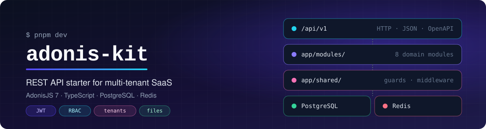
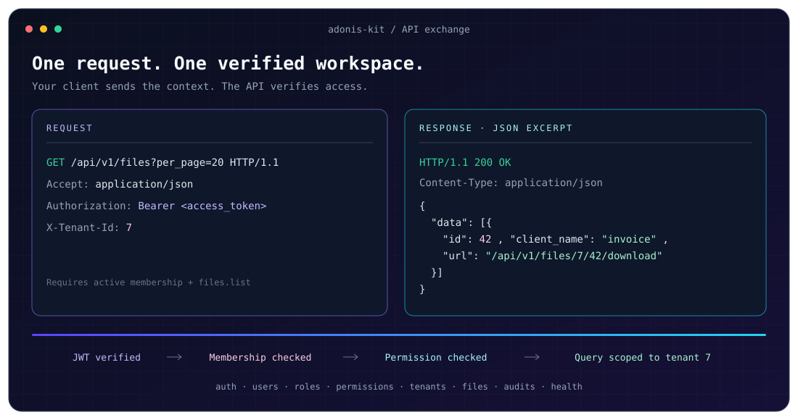

<div align="center">



<p>
  <a href="https://nodejs.org/"></a>
  <a href="https://adonisjs.com/"></a>
  <a href="https://www.typescriptlang.org/"></a>
  <a href="https://www.postgresql.org/"></a>
  <a href="https://redis.io/"></a>
  <a href="https://github.com/gabrielmaialva33/adonis-kit/actions/workflows/ci-cd.yml"></a>
  <a href="package.json"></a>
  <a href="LICENSE"></a>
</p>

**English** · [Português](README-pt.md)

---

_"Your API foundation, from the first login to the next workspace."_



</div>

---

> [!IMPORTANT]
> **adonis-kit is a REST API starter for multi-tenant SaaS.** AdonisJS 7, domain modules, JWT authentication,
> rotating refresh tokens, tenant workspaces, hierarchical RBAC and private file storage are already connected.
> Bring your own web, mobile or service client. Edge is used for email templates.
> This is a **pre-1.0 template (0.9.0)**: review [MIGRATION.md](MIGRATION.md) before adopting it in an existing application.

## Overview

<table>
  <tr>
    <td width="33%" valign="top"><h3>🔐 Account lifecycle</h3>Sign-up, sign-in, email verification, password reset, rotating refresh tokens and account deletion.</td>
    <td width="33%" valign="top"><h3>🏢 Tenant workspaces</h3>N:N memberships through <code>user_tenants</code>, active workspace selection and tenant-scoped private files.</td>
    <td width="33%" valign="top"><h3>👥 Hierarchical RBAC</h3>Global roles, inherited permissions, direct and temporary grants, ownership checks and Redis permission caching.</td>
  </tr>
  <tr>
    <td valign="top"><h3>📁 Private storage</h3>Upload, list, download and delete on filesystem, S3, DigitalOcean Spaces, Cloudflare R2 or GCS.</td>
    <td valign="top"><h3>📖 HTTP contracts</h3>JSON endpoints, VineJS validation, rate limiting, OpenAPI, ReDoc and runnable HTTP examples.</td>
    <td valign="top"><h3>🧪 Backend validation</h3>Japa unit and functional suites, deployment checks, PostgreSQL and Redis integration tests.</td>
  </tr>
</table>

| Property  | Value                                                                                |
| :-------- | :----------------------------------------------------------------------------------- |
| Package   | `adonis-kit` 0.9.0 · MIT                                                             |
| Runtime   | Node **24.21.0** ([.nvmrc](.nvmrc)), pnpm **11.22.0** ([package.json](package.json)) |
| Backend   | AdonisJS 7, Lucid ORM, VineJS, TypeScript 6/7                                        |
| Data      | PostgreSQL; Redis for permissions/cache and optional rate-limit storage              |
| Reference | `/docs`, `/docs/openapi.yaml`, [HTTP examples](docs/api.http)                        |

## Quick start

Activate the pinned Node version and pnpm before running these commands. With Mise, use `mise exec node@24.21.0 -- <command>`.

```sh
git clone https://github.com/gabrielmaialva33/adonis-kit.git
cd adonis-kit
pnpm install --frozen-lockfile
cp .env.example .env
pnpm ace generate:key
```

Set up PostgreSQL, Redis and a development mail service; the [Docker setup](#docker-and-ci) provides them.
Configure `.env` from [.env.example](.env.example), then initialize your **development** database:

```sh
pnpm ace migration:run
pnpm ace db:seed
pnpm dev
```

Open `http://localhost:3333/docs` or request `http://localhost:3333/api/v1/health`. Seeders create development sample data;
create your own account through `POST /api/v1/sessions/sign-up`. Use `pnpm ace`, not `node ace`.

> [!IMPORTANT]
> Before 1.0, unshipped schema changes belong in the original `create_*` migration. Recreate disposable development/test
> databases after those changes. Existing application data needs a separate, reviewed migration plan.

## Architecture

```text
app/modules/       auth · users · roles · permissions · tenants · files · audits · health
app/shared/        JWT guard, middleware, shared services and Lucid repository
app/exceptions/    typed errors
start/             environment validation, middleware and route registration
config/            framework and integration configuration
database/          migrations, factories and seeders
resources/         Edge email templates and translations
tests/             Japa unit and functional suites
docs/              OpenAPI, ReDoc and HTTP examples
```

Follow **controller → service → repository → model**, with `@inject()` for dependencies. Modules own their `routes.ts`.
Use `#modules/*`, `#shared/*` and `#exceptions/*`, plus the aliases declared in `package.json`.
Ace generators target the framework's default layout; move generated files into the owning module and fix their imports.
See [AGENTS.md](AGENTS.md) and [CLAUDE.md](CLAUDE.md) for repository conventions.

## API

Browse ReDoc at `/docs`; download the specification at `/docs/openapi.yaml`. The source contract is
[docs/openapi.yaml](docs/openapi.yaml), with request examples in [docs/api.http](docs/api.http).
[The migration guide](MIGRATION.md) maps the previous API's routes and explains payload, credential and storage changes.

| Group                 | Endpoints                                                                                            | Purpose                                                                 |
| :-------------------- | :--------------------------------------------------------------------------------------------------- | :---------------------------------------------------------------------- |
| Sessions              | `/api/v1/sessions/*`                                                                                 | Sign-up, sign-in, CSRF bootstrap, refresh, logout and password recovery |
| Verification          | `/api/v1/verify-email`, `/api/v1/resend-verification-email`                                          | Verify email or resend a link                                           |
| Current account       | `/api/v1/me`, `/api/v1/me/roles`, `/api/v1/me/permissions`                                           | Profile, roles/permissions and account deletion                         |
| Users                 | `/api/v1/users`, `/api/v1/users/:id`                                                                 | Authorized listing and CRUD; deletion is soft                           |
| Roles and permissions | `/api/v1/admin/roles/*`, `/api/v1/admin/permissions`, `/api/v1/admin/users/*`                        | Role assignment and permission administration                           |
| Tenants               | `/api/v1/tenants`, `/api/v1/tenants/me`, `/api/v1/tenants/switch`                                    | Create, list memberships and switch workspaces                          |
| Files                 | `/api/v1/files`, `/api/v1/files/upload`, `/api/v1/files/:id`, `/api/v1/files/:tenantId/:id/download` | Private file lifecycle                                                  |
| Operations            | `/api/v1/health`, `/version`                                                                         | Readiness and package information                                       |

```sh
curl http://localhost:3333/api/v1/sessions/sign-in \
  -H 'Content-Type: application/json' \
  -d '{"uid":"person@example.com","password":"development-password"}'

curl http://localhost:3333/api/v1/files \
  -H 'Authorization: Bearer <auth.access_token>' \
  -H 'X-Tenant-Id: <tenant_id>'
```

## Auth, tenants and permissions

| Concern       | Contract                                                                                                                                                                                                                   |
| :------------ | :------------------------------------------------------------------------------------------------------------------------------------------------------------------------------------------------------------------------- |
| Bearer        | Default mode. Send `Authorization: Bearer <auth.access_token>`. Sign-in accepts `uid` and `password`; sign-up requires a confirmed password of at least 8 characters.                                                      |
| Cookie + CSRF | Send `auth_mode: "cookie"` on sign-in, sign-up or refresh. First call `GET /api/v1/sessions/csrf`, retain cookies and send its JSON `csrf_token` as `X-CSRF-TOKEN` on unsafe requests. Cookie issuance also requires CSRF. |
| Tokens        | Access JWT: **15 minutes**. Opaque refresh: **3 days**. Send `refresh_token` to `/api/v1/sessions/refresh` and replace both saved credentials with the returned pair. Serialize refresh calls.                             |
| Active tenant | `X-Tenant-Id` → verified JWT `tenantId` → first active membership. Explicit inaccessible tenants are rejected. Switch accepts `tenant_id` and issues a new credential pair.                                                |
| Authorization | Tenant membership and global RBAC are separate. Permission assignment requires ROOT; non-ROOT actors can delegate only permitted lower roles.                                                                              |
| Files         | Queries use verified `ctx.tenant.id`; downloads check membership in the tenant embedded in the URL. Download URLs require authentication and `files.read`.                                                                 |

Cookie mode still returns the token pair in JSON; only the access JWT is stored in the HttpOnly cookie. Unsafe requests
carrying that cookie require CSRF even if an Authorization header is present. Alternatively, send the `XSRF-TOKEN`
cookie value as `X-XSRF-TOKEN`; it is **not** the JSON bootstrap token. See [HTTP examples](docs/api.http).

Replaying a consumed refresh invalidates the current credential generation. Password changes/reset and account deletion
invalidate earlier credentials. Logout revokes the submitted refresh; already-issued Bearer access JWTs can remain valid until expiry.

Users, roles, permissions and audit records remain **global**. New tenant-owned entities must declare `tenant_id` and scope
repository operations to the verified tenant. `REGISTRATION_WORKSPACE_MODE=personal` creates a workspace at sign-up;
`none` leaves membership provisioning to your application.

## Configuration

[.env.example](.env.example) documents the variables validated by [start/env.ts](start/env.ts).

| Variables                                                                                           | Purpose                                                                                        |
| :-------------------------------------------------------------------------------------------------- | :--------------------------------------------------------------------------------------------- |
| `APP_NAME`, `APP_URL`, `APP_SOURCE_URL`                                                             | Application identity and generated links                                                       |
| `APP_KEY`                                                                                           | Encryption key generated with `pnpm ace generate:key`                                          |
| `ACCESS_TOKEN_SECRET`, `REFRESH_TOKEN_SECRET`, `EMAIL_VERIFICATION_SECRET`, `PASSWORD_RESET_SECRET` | Independent production token/HMAC secrets                                                      |
| `JWT_ISSUER`, `JWT_AUDIENCE`, `JWT_COOKIE_NAME`, `SESSION_COOKIE_NAME`, `SESSION_DRIVER`            | Token identity, cookies and CSRF sessions                                                      |
| `PASSWORD_RESET_URL`, `PASSWORD_RESET_TTL_MINUTES`                                                  | Optional external reset page and link lifetime; without a URL, emails contain API instructions |
| `REGISTRATION_WORKSPACE_MODE`                                                                       | `personal` or `none`                                                                           |
| `DB_*`, `REDIS_*`, `LIMITER_STORE`                                                                  | Database, Redis and rate-limit backend (`database`, `redis`, `memory`)                         |
| `DRIVE_DISK`                                                                                        | `fs`, `s3`, `spaces`, `r2` or `gcs`; provider credentials are listed in the example            |
| `MAIL_MAILER`, `MAIL_FROM_*`, `SMTP_*`, `MAILGUN_*`                                                 | SMTP or Mailgun delivery                                                                       |

For production cookie clients, use HTTPS, a public HTTPS `APP_URL`, and a reviewed trusted-proxy policy in
[config/app.ts](config/app.ts). Allow client origins explicitly in [config/cors.ts](config/cors.ts) and send
`credentials: 'include'`. Cookies default to `SameSite=Lax` and are `Secure` in production; CORS alone does not enable
cross-site cookies. Review access/session/XSRF cookie policy together without disabling CSRF.

Use independent secrets and private bucket policies. `GCS_KEY`, when provided, must be valid service-account JSON;
leave it unset for ADC. Existing public cloud objects require a separate access-policy migration.

## Commands

| Command                       | Purpose                                                                                  |
| :---------------------------- | :--------------------------------------------------------------------------------------- |
| `pnpm dev`                    | API development server with HMR                                                          |
| `pnpm ace <command>`          | Ace commands, including migrations and seeders                                           |
| `pnpm build`                  | Compile the production API into `build/`                                                 |
| `pnpm start`                  | Run the compiled API from the build directory with production dependencies/configuration |
| `pnpm lint` / `pnpm lint:fix` | ESLint checks / fixes                                                                    |
| `pnpm typecheck`              | Backend TypeScript check                                                                 |
| `pnpm test`                   | Japa unit suite                                                                          |
| `pnpm test:e2e`               | All Japa unit and functional suites                                                      |
| `pnpm format`                 | Prettier                                                                                 |
| `pnpm docker`                 | Compiled application: run migrations and start the server; does not seed                 |

TypeScript 7 (`typescript-native`) supplies `tsc`; the `typescript` alias retains TypeScript 6 for tooling compatibility.
The exact versions and scripts live in [package.json](package.json).

## Testing

| Suite      | Location                        | Runner                 | Timeout |
| :--------- | :------------------------------ | :--------------------- | :------ |
| Unit       | `tests/unit/**/*.spec.ts`       | Japa                   | 2 s     |
| Functional | `tests/functional/**/*.spec.ts` | Japa + HTTP API client | 30 s    |

Both suites boot the application and need PostgreSQL and Redis. Bootstrap runs migrations/seeders; functional tests
flush the selected Redis database. **Use dedicated disposable instances**, never application data.
The tracked `.env.test` contains synthetic defaults, including SMTP `127.0.0.1:9`; tests fake email delivery.
Override `DB_*` and `REDIS_*` for your test infrastructure. There is no frontend or browser suite.

## Docker and CI

```sh
docker compose up -d postgres redis mailpit
docker compose up --build
```

The first command starts infrastructure for `pnpm dev`; the second runs the full stack. The [Compose file](docker-compose.yml)
uses PostgreSQL 16, Redis 7 and Mailpit (SMTP `1025`, inbox `8025`). The API uses port `3333`. With a remote Docker context,
published ports belong to that remote host, so configure host-side database/Redis/mail connections accordingly.

The multi-stage [Dockerfile](Dockerfile) installs production dependencies, runs pending migrations and starts the compiled
server. Compose persists private filesystem uploads at `/app/storage` in the `uploads` volume. Its credentials are development
placeholders: replace every secret outside disposable environments, and provide HTTPS for production cookie clients.

[CI](.github/workflows/ci-cd.yml) runs on pushes to `main`/`develop` and pull requests to `main`:
frozen install → lint → typecheck → Japa unit/functional → build, with PostgreSQL and Redis service containers.

## Contributing

Read [CONTRIBUTING.md](CONTRIBUTING.md), [CODE_OF_CONDUCT.md](CODE_OF_CONDUCT.md) and [SECURITY.md](SECURITY.md).
Follow the modular architecture and add regression coverage for behavior changes. Before submitting:

```sh
pnpm lint && pnpm typecheck
pnpm test:e2e && pnpm build
```

Use [issues](https://github.com/gabrielmaialva33/adonis-kit/issues) for bugs/proposals and the private reporting channel
in the security policy for vulnerabilities.

## License

[MIT](LICENSE).

---

<div align="center">

**adonis-kit · Gabriel Maia**

_Built on AdonisJS, for products that grow one workspace at a time._


</div>
